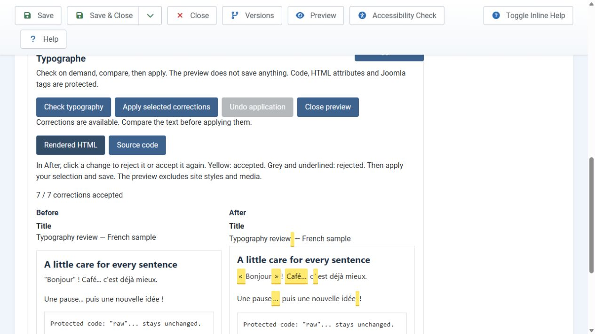
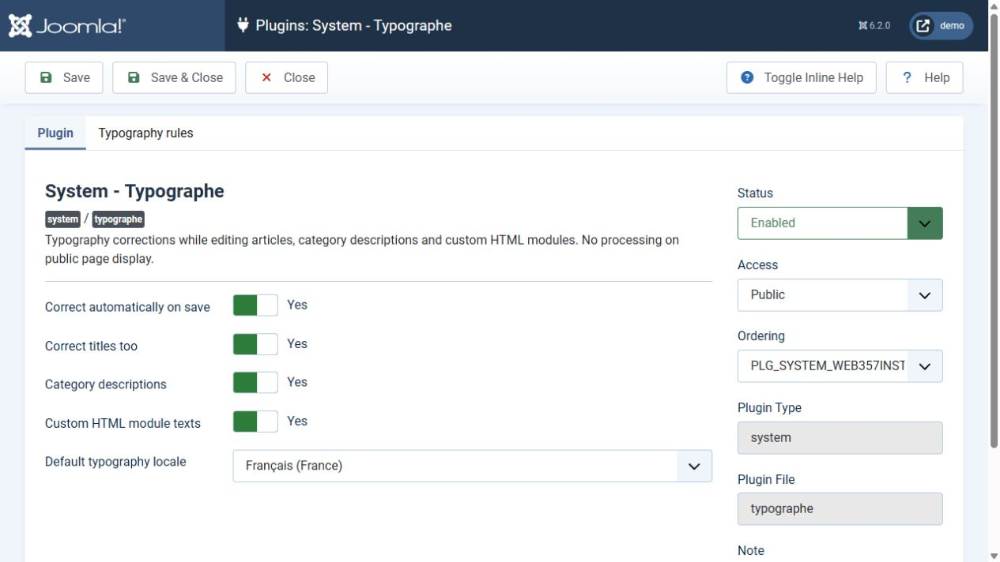
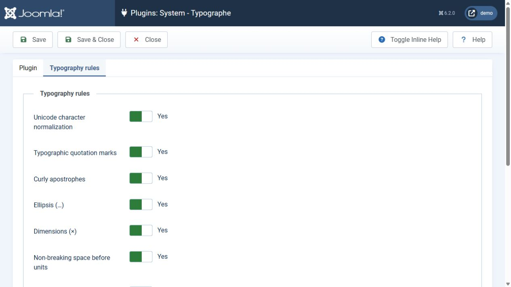

# Typographe 2.0.9 — English guide

[Home](../README.md) · [Français](README.fr.md)

## Installation and upgrades

1. Back up your site before upgrading.
2. Download `plg_system_typographe-2.0.9.zip` from [GitHub releases](https://github.com/YGomiero/typographe/releases/tag/2.0.9).
3. Install the ZIP through Joomla: **System → Install → Extensions**.
4. Enable **System - Typographe** and review its settings.

Requirements: Joomla 6, PHP 8.3 or later, DOM and mbstring PHP extensions. Dependencies are bundled; runtime does not require Composer or network access.

Upgrades preserve the historical parameter names and remove obsolete 1.x engine files. The old French spacing option retains its Yes/No value but now controls language-aware punctuation spacing. Unicode normalization is enabled by default. Existing content is not processed in bulk. Joomla 3, 4 and 5 are outside this release's target.

## Supported editing contexts

- Articles: introduction, full text and optional title.
- Categories: description and optional title.
- Custom HTML modules: content and optional title.

The review panel is available in the administrator interface. Automatic correction also supports frontend article form saves. Public page display adds no Typographe panel, JavaScript or CSS and performs no correction. On a public GET request, Joomla only initializes an inert plugin shell; JoliTypo is not loaded. API imports and operations without an editing field are ignored.

## Review and choose changes

1. Open an editing form and choose **Check typography**.
2. Compare **Before** and **After** using **Rendered HTML**, or switch to **Source code**.
3. Click a change directly in **After** to reject or accept it again. **Yellow: accepted. Grey and underlined: rejected.** All changes start accepted. Keyboard users can press Tab, then Enter or Space.
4. Click **Apply selected corrections** to transfer your choices to the editor.
5. Save the Joomla form to persist the result.

The preview and individual clicks do not change the editor or database. **Close preview** leaves the text untouched. **Undo application** restores the previous editor version if it has not been edited since applying. A stale proposal cannot overwrite newer edits.

Rendered preview preserves text structure without template styles, external media or executable elements. Comparison markers are never saved. Adjacent changed characters form one correction; very large complex differences may be grouped to bound processing cost.

### Hyphenation and apparently unchanged words

Discretionary hyphenation inserts an invisible character (U+00AD) that permits a word to break at the end of a line. A highlighted word can therefore keep exactly the same spelling. Since 2.0.9, the preview explains these changes and keeps hyphenated words individually selectable in long articles. Highlights flow with the text without introducing artificial line breaks. Reject the suggestion or disable **Discretionary hyphenation** to avoid adding these break opportunities.

## Automatic mode and manual decisions

**Automatically correct on save** is enabled by default. Disable it for a manual-only workflow.

An applied manual selection overrides automatic correction **for the exact revision submitted in that save**: rejected changes are not reapplied. Typographe also recognizes TinyMCE HTML serialization and form line endings, so they no longer cause rejected changes to be reapplied. Rejections are not permanent exclusions. Check again or disable automatic mode if you edit the text afterwards or reopen it for another editing session. Undoing an application does not disable automatic mode.

## Language and rules

Content language determines typography conventions independently of the interface language. Content assigned to All languages uses the plugin's default locale, initially French (France).

| Option | Effect |
| --- | --- |
| Unicode character normalization | Composes pasted accents into NFC without changing their appearance; runs first. |
| Language-aware punctuation spacing | Uses JoliTypo conventions: non-breaking spaces for French (France), removal of the relevant spaces for English and Canadian French. |
| Smart quotes and apostrophes | Replaces straight forms according to locale. |
| Ellipsis | Replaces `...` with `…`. |
| Dimensions | Uses the multiplication sign `×`. |
| Units | Joins numbers and units with a non-breaking space. |
| Dashes | Applies typographic dashes and spacing. |
| Spaces before commas | Removes unnecessary spaces. |
| Optional hyphenation | Adds discretionary word breaks; disabled by default. |
| Trademark and copyright | Converts supported notations to symbols. |

Each rule can be disabled. Titles, categories and modules also have independent switches.

## Protection and limitations

HTML tags and attributes, comments, `pre`, `code`, `script`, `style`, `textarea`, SVG, MathML, iframe blocks, URLs, email addresses and Joomla `{...}` tags are preserved. Use `class="notypo"` or `data-typographe-ignore` to exclude a passage. Entities in modified text segments may be normalized to UTF-8.

Quotes spanning multiple HTML tags may need manual correction. Custom fields, metadata descriptions and third-party components are not integrated in this release. The review endpoint requires an administrator session, POST, a CSRF token and create/edit permissions; it does not save data. Input limits: 1 MB of body text and 10 KB of title text.

Since 2.0.6, Joomla detects stable GitHub releases through its native update manager. Install 2.0.9 once to register the channel, then use System → Update → Extensions. Detection is automatic; installation is started by the administrator without manually downloading the ZIP. Joomla content history can help restore changes when enabled, but does not replace a backup.

## Validation and dependencies

39 engine tests, 19 hyphenation regression checks, 16 Joomla integration tests and a JavaScript comparison/selection suite covering long articles and 100 reproducible randomized cases. Browser checks on Joomla 6.2.0 / PHP 8.3.30 cover preview, mouse/keyboard toggling, apply/undo, a save preserving rejected corrections, and Unicode normalization with protected code.

JoliTypo 1.8.0, Hyphenator 3.2.0 and Symfony Intl Normalizer polyfill 1.43.0 are pinned by Composer. See the [main README](../README.md) for build and test commands.

Support: [Report an issue or ask a question on GitHub](https://github.com/YGomiero/typographe/issues)

## Screenshots

Actual Joomla 6.2.0 screenshots, English interface with a French example.

### Compare rendered content

### Choose individual corrections

### Configure the editing workflow

### Choose typography rules

